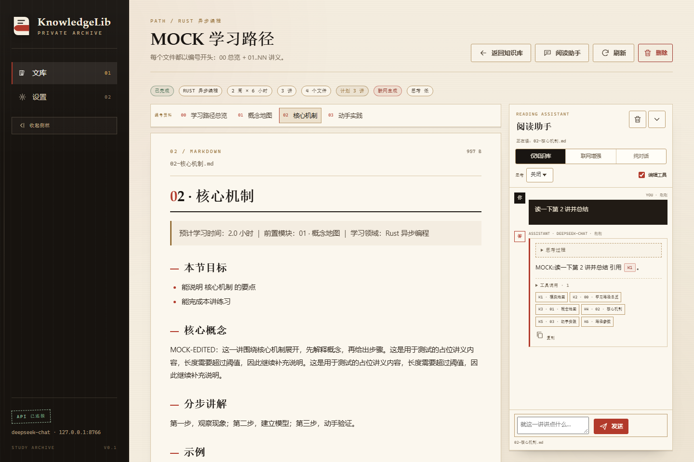
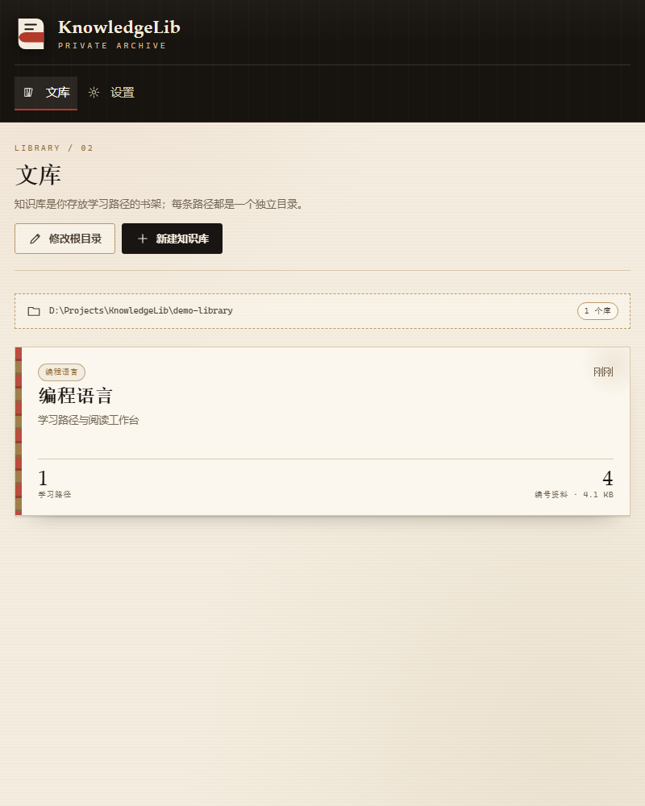

# KnowledgeLib · 私人文库

一个本地运行的「学习路径生成 + 阅读工作台」Web 应用：输入想学的领域、预期学习时间和偏好，生成一整套带编号的 Markdown 学习资料；打开任意一讲阅读时，可以在右侧阅读助手里边读边问，也可以调用 DeepSeek 的 WebSearch / WebFetch 补充最新信息。

- 后端：Python 3.11+、FastAPI、Uvicorn、httpx（uv 管理环境，默认 USTC 镜像）
- 前端：原生 HTML / CSS / JavaScript，无构建步骤、无外部 CDN
- 测试：pytest + Python Mock 上游，全程不接触真实 API Key

## 界面

以下截图使用本地 Python Mock 上游，不包含真实 API Key。

## 最终产物标准

一个知识库对应根目录下的一个独立文件夹；一个学习路径再占一个子文件夹。每次生成固定得到：

    00-学习路径总览.md
    01-<第一讲>.md
    02-<第二讲>.md
    ...
    NN-<第 N 讲>.md

硬性约定：

1. 每个 .md 文件的第一行都是编号标题，格式为 "# NN · 标题"（总览为 00）。
2. 文件名同样以两位编号开头。
3. 00 总览包含领域、周期、每周投入、总时长、学习目标、模块地图表格（链接到每一讲）、学习节奏建议与完成清单。
4. 每讲包含编号标题、预计学习时间、前置模块、本节目标，以及核心概念、分步讲解、示例、常见误区、练习、自测清单、延伸阅读。
5. 生成可中断；已完成讲次保留，路径状态变为「部分完成」，之后可以继续生成缺失章节。

## 联网生成与思考强度

新建学习路径时，表单里有两个增强选项：

- **联网生成**：仅 DeepSeek 模型可用。应用会向模型声明 `deepseek_web_search`（思考关闭时再加 `deepseek_read_url`），并自动使用 `deepseek-flash`。模型在规划与写讲义时自行搜索、阅读和引用；非 DeepSeek 服务会拒绝该选项。
- **思考强度**：关闭 / 低 / 高 / 最高，对应 Chat Completions 的 `thinking` 与 `reasoning_effort`。开启后应用会保留 `reasoning_content`，在带工具的后续轮次中回传，避免 DeepSeek 工具调用上下文断裂。

阅读助手同样可以单独设置思考强度。DeepSeek 的 `read/edit/write/highlight` 函数工具只有两种合法组合：**联网 + 思考开启**（服务端 `deepseek_web_search` 伴随函数工具），或**仅知识库/纯对话 + 思考关闭**（不声明服务端工具）。其余组合应用会自动暂停编辑工具并提示，不会把非法组合发给 DeepSeek。

## 阅读助手与文档工具

阅读页右侧的助手会拿到当前文件与当前路径的文件列表，并向模型开放四个工具：

- `read`：读取当前路径内的一篇 Markdown。
- `edit`：对已有文件做一次精确替换；修改后仍须保留 `# NN · 标题` 首行，并把旧版本备份到 `data/trash/edits/`。
- `write`：新建讲义。文件名必须为 `NN-标题.md`（01..99，不能用 00），正文首行必须为 `# NN · 标题`，且至少包含 `## 本节目标` 与 `## 核心概念`；规范写在工具描述里，模型可直接看到。
- `highlight`：把原文片段用黄色荧光笔标出；支持跨行、跨 `代码` / **粗体** 等行内标记匹配，不修改文件。

这些工具可以在助手顶部用「编辑工具」开关关闭；执行过程会以工具日志显示，编辑/新建后正文与编号文件条会自动刷新。

DeepSeek 对 client tools 与服务端工具的组合有硬限制：思考开启时可以伴随 `deepseek_web_search`，思考关闭时则不能同时声明服务端工具。因此：

- 普通问答（仅知识库 / 纯对话）+ 思考开启：应用会**自动暂停编辑工具**，只回答问题，并在界面上提示；关闭思考后才能编辑。
- 联网增强 + 关闭思考：保留服务端 `deepseek_web_search`，编辑工具自动暂停；打开思考后即可继续编辑。
- 联网增强 + 思考开启：服务端 `deepseek_web_search` 与编辑工具同时声明，这是 API 允许的组合。
- 生成流程只有服务端工具，没有 client tools，不受此限制。

## 主题与兼容性

设置 → 外观：

- **档案室**：默认主题，暖纸底色、衬线标题、朱砂与黄铜点缀。
- **现代**：冷色渐变背景、圆角玻璃卡片、较大的标题与无衬线展示字体。
- **液态玻璃**（仅现代主题）：启用 [liquidGL](https://github.com/naughtyduk/liquidGL) 为阅读助手加玻璃霜面与高光；不支持 WebGL、软件渲染或窄屏时自动回退为 CSS 玻璃。侧栏与卡片始终使用 CSS 玻璃。
- **禁用衬线字体**：兼容性选项，把标题、正文、引用与界面文字全部切到无衬线字体。

主题、液态玻璃与字体开关保存在本机浏览器的 `localStorage`，不写入用户配置文件，也不影响不同设备。

## 快速开始

    uv sync
    uv run python app.py

打开 http://127.0.0.1:8765 。也可以直接用启动脚本：

- Windows：run.cmd
- Linux / macOS / Git Bash：./run.sh

脚本会在 .venv 缺失时自动执行 uv sync，并原样透传参数；设置 NO_INSTALL=1 可禁止自动安装。

### 镜像

pyproject.toml 默认使用 USTC 镜像。切换 TUNA：

    uv sync --default-index https://pypi.tuna.tsinghua.edu.cn/simple

### 常用参数

    uv run python app.py --host 127.0.0.1 --port 8765 --data-dir data --open
    uv run python app.py --selftest

默认只监听 127.0.0.1。只有显式使用 --host 0.0.0.0 才会对局域网开放（启动横幅会提示风险）。

## 使用流程

1. 设置 → 模型服务：填 Base URL / API Key / 模型，保存并测试连接。支持任意 OpenAI Chat Completions 兼容服务；本地服务可以留空 Key。
2. 设置 → 知识库根目录：选择或新建一个目录，保存时会自动创建并验证可写。
3. 文库 → 新建知识库：例如「编程语言」。
4. 进入知识库 → 新建学习路径：填领域、周期、每周小时、基础水平、目标标签、偏好要求与模块数。
5. 生成进度页可以取消；完成后进入阅读工作台，文件按编号排列。
6. 阅读工作台：上方编号条切换文件，右侧「阅读助手」提供仅知识库 / 联网增强 / 纯对话三种模式；当前文件会自动作为上下文。
7. 知识库页和学习路径页都有「重命名」按钮，只改显示名称，不改磁盘目录名与文件内容。
8. 右侧阅读助手和左侧主导航都可以展开或收起，状态会记在浏览器里。

### 首次使用建议值

- 领域：Rust 异步编程
- 周期：4 周，每周 10 小时
- 水平：零基础
- 目标：项目实战
- 偏好：偏重可运行示例，每天只能投入 1.5 小时

## DeepSeek 联网接口

应用直接调用官方原始 JSON 接口（不是 Chat Completions 的服务端工具声明）：

- Search：POST https://api.deepseek.com/v1/tools/search
- Fetch：POST https://api.deepseek.com/v1/tools/fetch

在设置的「DeepSeek 联网接口」里配置 Base URL（默认 https://api.deepseek.com/v1）、可选的独立 Key、默认搜索条数与自动抓取网页数。阅读助手的「联网增强」模式会：

1. 用用户问题调用 Search；
2. 取前若干条结果，对 topN 条 URL 并行调用 Fetch；
3. 抓取失败时回退到搜索结果 summary；
4. 把结果以 [W1]..[Wn] 注入上下文，并显示来源。

计费提示：Search / Fetch 按成功请求计费（参考价每千次约 5 元），测试按钮会产生 2 次请求。接口文档：

- https://api-docs.deepseek.com/zh-cn/guides/search.md
- https://api-docs.deepseek.com/zh-cn/guides/web_tools.md

UI 已不再提供独立的联网调试页；/api/web/* 作为代理接口保留，阅读助手的「联网增强」模式使用同一后端。

## 配置与数据

配置文件放在当前用户目录，不再写进项目目录：

- Windows：`%APPDATA%\KnowledgeLib\settings.json`
- macOS / Linux：`~/.config/knowledgelib/settings.json`（遵循 `XDG_CONFIG_HOME`）
- 可用 `--config-dir` 或 `KL_CONFIG_DIR` 覆盖；旧版 `data/settings.json` 会在首次启动时自动迁移。

`data/` 只放运行时数据：

    data/
      library/                      默认知识库根目录（可在设置中改）
        编程语言/
          .kb.json                  知识库元数据
          Rust异步编程/
            .path.json              路径、生成参数、规划与状态
            00-学习路径总览.md
            01-异步基础.md
      trash/                        软删除的目录与编辑备份
        edits/                      编辑工具写回前的旧版本

- 删除知识库 / 学习路径会移动到 data/trash/<时间戳>-<目录名>/，不会直接抹掉。
- 路径生成中禁止删除。
- 所有文件访问都会校验是否落在知识库根目录内，拒绝 ..、绝对路径、盘符与符号链接逃逸；编辑工具也走同一层校验。

## 环境变量

- KL_API_KEY / KL_WEB_API_KEY：Key 优先于 settings.json
- KL_BASE_URL / KL_MODEL：覆盖模型服务地址与模型
- KL_WEB_BASE_URL：覆盖联网接口地址
- KL_KB_ROOT：覆盖知识库根目录
- KL_DATA_DIR：覆盖运行时数据目录
- KL_CONFIG_DIR：覆盖用户配置目录
- KL_QUIET=1：关闭访问日志（测试用）
- KL_PORT：默认端口（启动参数 --port 优先）

## 测试（不使用真实 Key）

全部测试使用本地 Python Mock 上游（tests/mock_upstream.py），只监听 127.0.0.1，不访问外网；当前共 78 个 pytest 用例：

    uv run pytest -q
    uv run python tools/selfcheck.py
    uv run python app.py --selftest

覆盖内容：

- 设置、Key 掩码、环境变量优先级、坏 JSON 自愈
- 知识库 / 学习路径目录、重命名、软删除、路径穿越拒绝
- 中文 BM25 检索、分块、缓存失效
- 规划 JSON 解析与修复、编号标题、总览模板、并发生成
- 讲义失败 → 部分完成 → 续生成
- SSE 事件顺序（ASGI 与真实 socket 两种）
- 对话引用、知识库 + 联网、Search / Fetch 代理与错误映射
- 联网 / 思考四种组合下自动暂停非法编辑工具，避免服务端工具与函数工具混用
- DeepSeek 服务端 web_tools、思考参数、reasoning_content 回传、工具调用轮次
- read / edit / write / highlight 文档工具与编号规范、编辑备份、路径穿越拒绝
- highlight 匹配器：跨行、跨行内代码/粗体/链接、Markdown 标记剥离
- 静态资源、JS 语法、byId 引用、启动脚本守卫
- 主题资源顺序、现代主题/无衬线 CSS、liquidGL 许可与 CSP worker 放行

Mock 也可以单独启动，用于无 Key 的界面演示：

    uv run python -m tests.mock_upstream --port 8766

然后在设置里把模型 Base URL 填 http://127.0.0.1:8766，模型填 mock-model，Key 填 test-key；联网 Base URL 填 http://127.0.0.1:8766/v1。若要演示联网生成/思考，把模型改成 deepseek-chat；Mock 会接受服务端工具声明并返回可解析的规划。

## API 一览

| 方法 | 路径 | 说明 |
| --- | --- | --- |
| GET | /api/health | 健康检查 |
| GET / PUT | /api/settings | 读取脱敏设置 / 部分更新 |
| POST | /api/settings/test | 1 条 ping 消息测试模型 |
| POST | /api/settings/test-web | Search + Fetch 各一次 |
| GET / POST | /api/kbs | 列出 / 新建知识库 |
| GET / PUT / DELETE | /api/kbs/{id} | 详情 / 重命名 / 软删除 |
| POST | /api/kbs/{id}/paths | 生成学习路径（SSE） |
| POST | /api/kbs/{id}/paths/{pathId}/resume | 续生成（SSE） |
| GET / PUT / DELETE | /api/kbs/{id}/paths/{pathId} | 路径详情 / 重命名 / 软删除 |
| GET | /api/kbs/{id}/file?path=&name= | 读取 .md |
| GET | /api/kbs/{id}/search?q=&topK= | 检索预览 |
| POST | /api/kbs/{id}/reindex | 重建索引 |
| POST | /api/web/search | DeepSeek Search 代理 |
| POST | /api/web/fetch | DeepSeek Fetch 代理 |
| POST | /api/chat | SSE 对话（或 stream=false 返回 JSON） |

SSE 生成事件：start、plan、module、file、status、done、error。
SSE 对话事件：meta、tool、sources、reasoning、delta、doc、highlight、usage、done、error。

## 项目结构

    app.py                命令行入口与 --selftest
    server/
      main.py             FastAPI 工厂、异常处理、静态资源
      config.py           设置与 Key 掩码
      library.py          知识库 / 路径 / 路径安全 / 软删除
      learning.py         规划、讲义、总览、编号写入、续生成
      indexer.py          分块、中文分词、BM25
      llm.py              OpenAI 兼容客户端、思考与工具调用
      doc_tools.py        read / edit / write / highlight 工具
      webtools.py         DeepSeek Search / Fetch
      prompts.py          规划 / 讲义 / 问答提示
      routes_*.py         API 路由
    web/                  原生前端
    tests/                Mock 与测试
    tools/selfcheck.py    一键静态检查 + 全量测试

## 第三方资源

- [liquidGL](https://github.com/naughtyduk/liquidGL) v3.0.0，MIT License（仅 `scripts/` 源码；作者 NaughtyDuk）。本仓库内置一份于 `web/assets/vendor/liquidGL.js`，许可原文见 `web/assets/vendor/liquidGL-LICENSE.txt`。
- 其余图标为内联 SVG；界面不依赖外部 CDN、字体或图片。

## 设计说明

视觉方向是「档案室 / 私人图书馆」：暖纸底色、墨色侧栏、朱砂与黄铜点缀、索引卡式边框、编号与印章。没有外部字体或图片，离线可用；Markdown 渲染先整体转义，再解析结构，禁用原始 HTML 与 javascript: 链接。

## 已知边界

- 只支持 Markdown 资料；生成阶段一次调用规划 + 每讲一次讲义请求，模块数 3..20。
- 检索是词法 BM25，不包含向量模型；对中文与英文关键词有效，对纯语义改写较弱。
- 生成依赖模型严格遵循 JSON 规划提示；应用会在失败时修复一次，仍失败可重试。
- 不包含 PDF / OCR / 图片入库、多用户与权限、云同步、HTTPS 终结；Markdown 编辑只通过阅读助手工具完成，没有独立的富文本编辑器。
- API Key 保存在用户配置目录（尽力 chmod 600）；请勿把该文件或截图分享给他人。
- 服务端 web_tools 与 DeepSeek 的思考/联网组合绑定；使用其它 OpenAI 兼容服务时，联网生成不可用，思考参数可能被服务忽略。
- DeepSeek 思考模式与「仅函数工具」互斥：未开启联网时会自动收起编辑工具，这是服务端限制，不是前端开关失效。
