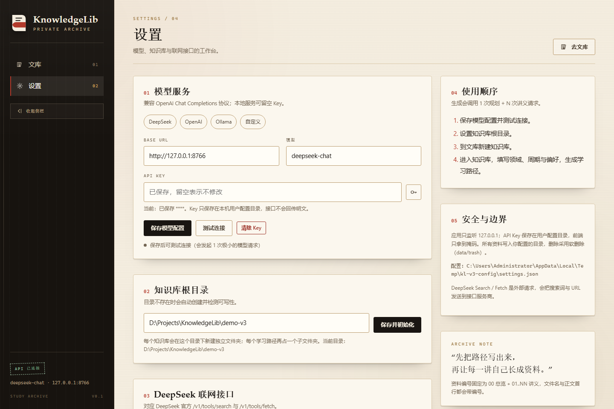
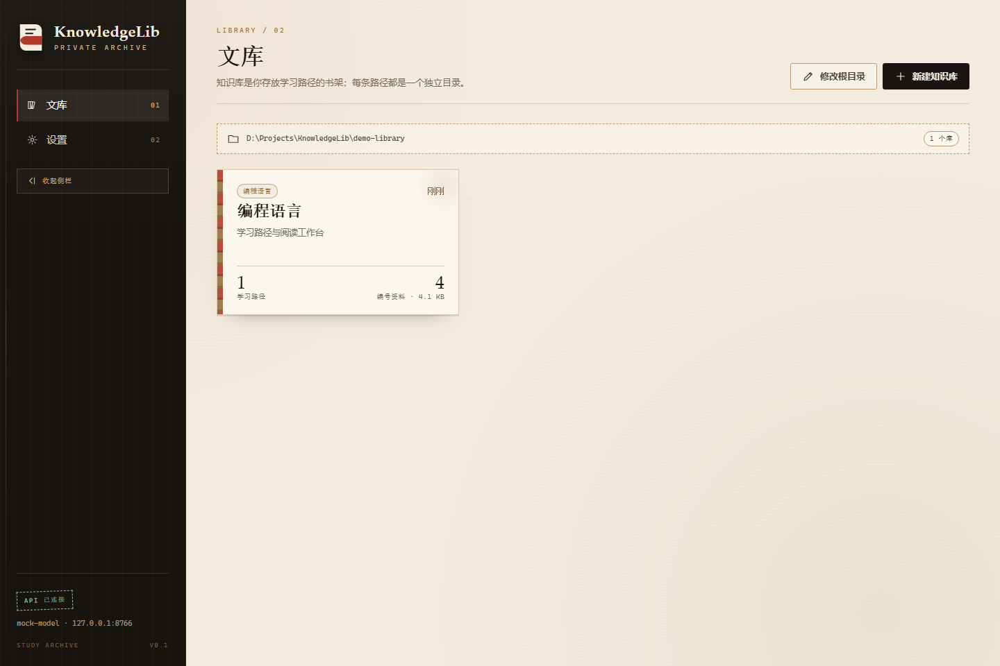
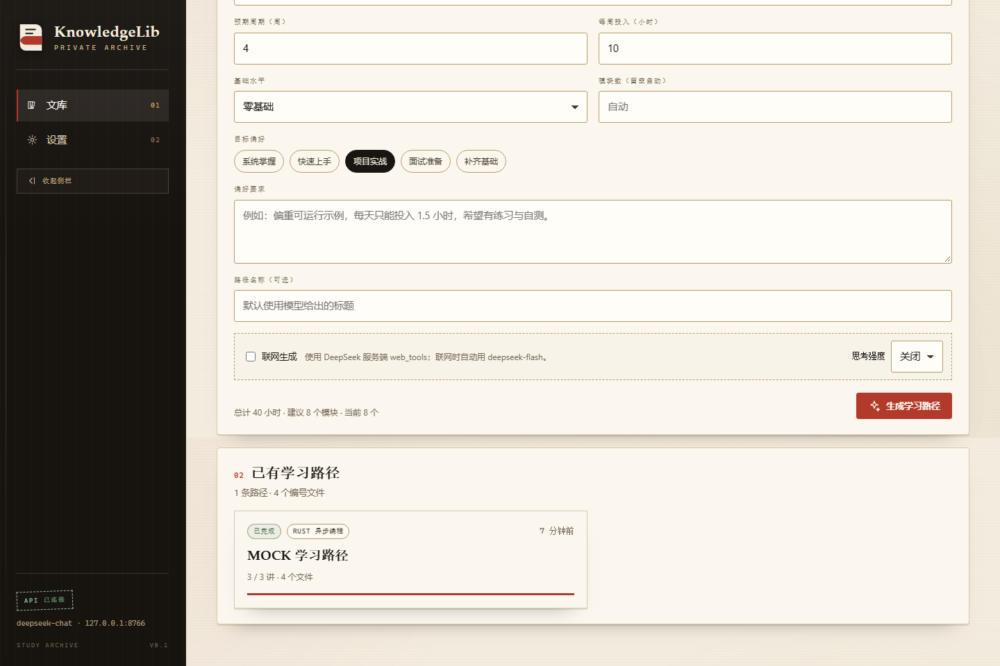

# KnowledgeLib · 私人文库

本地运行的「学习路径生成 + 阅读工作台」：输入想学的领域、周期、每周投入与偏好，生成一整套带编号的 Markdown 学习资料；阅读时在右侧助手里边读边问，需要最新信息时开启联网增强。

后端 Python 3.11+ / FastAPI / Uvicorn / httpx（uv 管理，默认 USTC 镜像）；前端原生 HTML / CSS / JavaScript，无构建步骤、无外部 CDN 与外部字体；测试用 pytest + 本地 Python Mock 上游，全程离线，不接触真实 API Key。

   

## 目录

[功能特性](#功能特性) · [界面截图](#界面截图) · [快速开始](#快速开始) · [使用流程](#使用流程) · [生成产物规范](#生成产物规范) · [阅读助手与文档工具](#阅读助手与文档工具)
[联网生成与思考强度](#联网生成与思考强度) · [主题与兼容性](#主题与兼容性) · [Git 同步](#git-同步) · [配置与数据](#配置与数据) · [环境变量](#环境变量) · [测试](#测试) · [API 一览](#api-一览)
[项目结构](#项目结构) · [第三方资源](#第三方资源) · [设计说明](#设计说明) · [已知边界](#已知边界) · [License](#license)

## 功能特性

- **学习路径生成**：领域（2..80 字符）、周期（1..52 周）、每周投入（1..40 小时）、基础水平、目标标签（最多 5 个）与偏好（≤500 字符）→ 1 份 JSON 规划 + 每讲 1 篇讲义；模块数 3..20，留空时按总时长取 `max(4, min(12, round(总时长 / 5)))`。
- **编号资料**：文件名 `NN-标题.md`、首行 `# NN · 标题`，`00` 固定为总览；总览含参数表、模块地图（链接到每一讲）与完成清单。
- **并发生成与续写**：讲义最多 3 讲同时撰写；生成可中断，已完成讲次保留，状态转为「部分完成」，之后只补缺失章节。
- **阅读工作台**：顶部编号文件条切换资料，Markdown 渲染支持表格、代码块、引用与站内跳转；`[K1]` / `[W1]` 引用可点开来源。
- **阅读助手**：仅知识库 / 联网增强 / 纯对话三种模式，当前文件与当前路径文件列表自动作为上下文；`read` / `edit` / `write` / `highlight` 四个文档工具可在顶部开关。
- **检索与联网**：中文友好的分词 + BM25；DeepSeek 模型可用服务端联网与四档思考强度，其他 OpenAI 兼容服务走应用侧 Search / Fetch 代理。
- **管理与外观**：知识库 / 学习路径可重命名（只写元数据），删除进 `data/trash/`；档案室与现代两套主题，现代主题可开液态玻璃或禁用衬线字体。
- **Git 同步**：整个知识库根目录共用一个仓库，一次同步所有知识库；支持绑定 origin、手动或按间隔自动同步、四种冲突策略，可把文库集上传到仓库内自定义名称的子文件夹，以及 `git` / `gh` 自定义命令。

## 界面截图

以下截图使用本地 Python Mock 上游生成，不含真实 API Key。








## 快速开始

需要 Python 3.11+ 与 [uv](https://docs.astral.sh/uv/)；可选 Node.js（`tools/selfcheck.py` 与 `tests/test_static.py` 用它做 `node --check`，未安装时跳过）。

```bash
uv sync
uv run python app.py
```

打开 http://127.0.0.1:8765 。也可以直接用启动脚本（`.venv` 缺失时自动执行 `uv sync`，参数原样透传；设置 `NO_INSTALL=1` 可禁止自动安装）：Windows 用 `run.cmd`，Linux / macOS / Git Bash 用 `./run.sh`。

参数：`--host`（默认 `127.0.0.1`，显式 `0.0.0.0` 才会对局域网开放并提示风险）、`--port`（默认 `8765` 或 `KL_PORT`）、`--data-dir`（默认 `./data`）、`--config-dir`（默认见[配置与数据](#配置与数据)）、`--open`（启动后开浏览器）、`--selftest`（离线自检，不启动服务）。

`pyproject.toml` 默认使用 USTC 镜像。切换 TUNA：

```bash
uv sync --default-index https://pypi.tuna.tsinghua.edu.cn/simple
```

## 使用流程

1. 设置 → 模型服务：填 Base URL / API Key / 模型，保存并测试连接。
2. 设置 → 知识库根目录：选择或新建目录；保存时会创建并检测可写性。
3. 文库 → 新建知识库（例如「编程语言」），进入后新建学习路径：填领域、周期、每周小时、基础水平、目标标签、偏好与模块数。
4. 生成进度页可取消；完成后进入阅读工作台，文件按编号排列。
5. 阅读工作台：编号条切换文件；右侧「阅读助手」选模式、思考强度与编辑工具；知识库页与学习路径页都可「重命名」（只改显示名，不动目录名与文件内容）。
6. 左侧主导航与右侧助手都可折叠，状态记在浏览器。

首次建议值：Rust 异步编程 · 4 周 · 每周 10 小时 · 零基础 · 项目实战 · 偏好「偏重可运行示例，每天只能投入 1.5 小时」。

## 生成产物规范

一个知识库对应根目录下的一个独立文件夹，一条学习路径再占一个子文件夹：

```text
<知识库根目录>/
  编程语言/
    .kb.json                     知识库元数据（id / name / slug / 描述 / 时间）
    Rust异步编程/
      .path.json                 路径元数据（生成参数、规划、每讲状态、模型、错误）
      00-学习路径总览.md
      01-异步基础.md
```

硬性约定：

1. 讲义文件名必须是 `NN-标题.md`（`NN` 为 01..99 的两位数字，`00` 只用于总览），首行必须是编号标题 `# NN · 标题`，编号与文件名一致。
2. 总览固定为 `00-学习路径总览.md`，含领域 / 周期 / 每周投入 / 总时长、学习目标、路径参数表、模块地图（链接到每一讲）、学习节奏建议与完成清单。
3. 每一讲由服务端统一渲染：编号标题、`预计学习时间 / 前置模块 / 学习领域` 引用行、`## 本节目标`，随后是 `## 核心概念`、`## 分步讲解`、`## 示例`、`## 常见误区`、`## 练习`、`## 自测清单`、`## 延伸阅读`。
4. 正常生成是 1 次规划 + 每讲 1 次讲义请求；规划 JSON 不合格或讲义过短时会自动修复、重写一次。讲义最多 3 讲并发。
5. 没有 `.path.json` 的同级目录会以「外部目录」列出，可阅读，但不能续生成。

## 阅读助手与文档工具

阅读页右侧助手会拿到当前文件与当前路径的文件列表，并按模式注入知识库检索结果或联网资料。工具调用以工具日志显示；`edit` / `write` 成功后正文与编号文件条自动刷新。

| 工具 | 作用 | 约束 |
| --- | --- | --- |
| `read` | 读取当前路径内的一篇 Markdown，省略 `file` 时读当前文件 | 单次最多返回 12000 字符，超出截断 |
| `edit` | 对已有文件做一次精确替换 | `old_text` 必须在文件中恰好出现一次；改后首行仍须是 `# NN · 标题`；旧版本备份到 `data/trash/edits/` |
| `write` | 新建一篇讲义 | 文件名 `NN-标题.md`（01..99，不能用 `00`）；首行 `# NN · 标题`；必须含 `## 本节目标` 与 `## 核心概念`；不覆盖已有文件；≤1 MiB |
| `highlight` | 用黄色荧光笔标出原文片段 | `quote` 须逐字出现（≤800 字符）；支持跨行与跨行内代码 / 粗体 / 链接匹配；只展示，不改文件 |

- 工具只接受当前学习路径目录下的 `.md` 文件，拒绝 `..`、子目录、绝对路径与非 `.md`；顶部「编辑工具」开关可整体关闭，被服务端限制时会禁用并显示原因（见[联网生成与思考强度](#联网生成与思考强度)）。
- 纯对话模式不检索知识库；仅知识库与联网增强模式会注入对应资料。

## 联网生成与思考强度

**生成选项**：联网生成仅 DeepSeek 可用，自动使用 `deepseek-flash`，声明 `deepseek_web_search`（思考关闭时再加 `deepseek_read_url`），非 DeepSeek 服务会拒绝该选项；思考强度分关闭 / 低 / 高 / 最高，对应 Chat Completions 的 `thinking` 与 `reasoning_effort`，DeepSeek 在关闭时发 `thinking: {"type": "disabled"}`。

DeepSeek 对 client tools 与服务端工具的组合有硬限制：**函数工具只能出现在「联网 + 思考开启」或「非联网 + 思考关闭」两种组合里**。其余组合后端会丢弃函数工具并返回 `suppressReason`，前端禁用编辑工具并提示，不会把非法组合发给 DeepSeek。

| 模式 | 思考 | 实际声明 | 结果 |
| --- | --- | --- | --- |
| 联网增强 | 开启 | `deepseek_web_search` + `read` / `edit` / `write` / `highlight` | 可问答，也可编辑 |
| 仅知识库 / 纯对话 | 关闭 | `read` / `edit` / `write` / `highlight` | 可问答，也可编辑 |
| 联网增强 | 关闭 | `deepseek_web_search` + `deepseek_read_url`，丢弃函数工具 | 编辑工具暂停，提示打开思考 |
| 仅知识库 / 纯对话 | 开启 | 无服务端工具，丢弃函数工具 | 编辑工具暂停，提示关闭思考 |

生成流程只声明服务端工具、不含 client tools，因此不受此限制；非 DeepSeek 服务没有服务端工具，函数工具照常声明；思考开启且声明了工具时，应用保留 `reasoning_content` 并在后续工具轮次回传，避免多轮上下文断裂。

**DeepSeek 原始接口**：应用也直接调用官方 JSON 接口（用于应用侧联网、`/api/web/*` 代理与设置页测试）——Search：`POST https://api.deepseek.com/v1/tools/search`；Fetch：`POST https://api.deepseek.com/v1/tools/fetch`。设置 →「DeepSeek 联网接口」可配 Base URL（默认 `https://api.deepseek.com/v1`）、可选独立 Key、默认搜索条数（默认 5，1..50）与自动抓取网页数（默认 2，0..5）。

阅读助手的联网增强在非 DeepSeek 服务下会：用问题调用 Search → 取前若干条结果，对 topN 条 URL 并行调用 Fetch → 抓取失败时回退到结果 summary → 以 `[W1]..[Wn]` 注入上下文并显示来源。

计费提示：Search / Fetch 按成功请求计费（参考价每千次约 5 元），设置页的「测试 Search + Fetch」会产生 2 次请求。接口文档见 <https://api-docs.deepseek.com/zh-cn/guides/search.md> 与 <https://api-docs.deepseek.com/zh-cn/guides/web_tools.md>；`/api/web/*` 作为代理接口保留，界面不再提供独立的联网调试页。

## 主题与兼容性

**档案室**（默认）：暖纸底色、衬线标题、朱砂与黄铜点缀。**现代**：冷色渐变背景、圆角玻璃卡片、较大的标题与无衬线展示字体。**液态玻璃**（仅现代主题）：用 [liquidGL](https://github.com/naughtyduk/liquidGL) 给阅读助手加玻璃霜面与高光，无可信 WebGL、软件渲染、Headless 或窄屏时回退为 CSS 玻璃，侧栏与卡片始终是 CSS 玻璃。**禁用衬线字体**：兼容性选项，标题、正文、引用与界面文字全部改用无衬线字体。

主题、液态玻璃与字体开关只保存在浏览器 `localStorage`（键为 `kl.theme` / `kl.glass` / `kl.noSerif`），不写入用户配置，也不跨设备同步。

## 文库集 Git 同步

设置 →「文库集 Git 同步」。整个知识库根目录共用一个 Git 仓库，覆盖根目录下的全部知识库；不再为每个知识库单独建仓库。

| 项 | 说明 |
| --- | --- |
| 初始化 | 在知识库根目录建立仓库（默认分支 main），写入基础 .gitignore，把全部知识库提交为首个版本；可同时填写远端。 |
| Remote | 支持 HTTPS、SSH、file:// 与本地路径，固定为 origin；远端地址存在根目录的 .git/config，不写进任何知识库元数据，凭据沿用系统 Git 配置。 |
| 范围 | 根目录下所有知识库、学习路径和 Markdown 资料一次性提交、拉取和推送。 |
| 仓库内目录 | 可选；把整个文库集上传到远端仓库的指定文件夹，支持多级路径与自定义名称（如 `知识库` 或 `notes/kb`）。同步只替换该文件夹，仓库内 README、其他目录等文件保持不变；留空时同步到仓库根目录。首次同步时若远端目录已有文件，需先拉取导入；拉取以远端目录为准，远端删除文件或整个目录会同步删除本地对应内容（有本地改动时按冲突策略处理）；重复同步不会产生空提交。清空该设置时，只要曾用文件夹模式同步过（或仍存在 `refs/kl` 快照），就会以 `git_mode_switch` 拒绝并阻塞同步，需先清理远端旧内容并重新保存 remote 重置同步状态与快照。 |
| 手动操作 | 拉取、推送、立即同步（先拉后推）与刷新状态；拉取使用 fetch + merge，不改写本地提交。 |
| 自动同步 | 全局间隔 1..1440 分钟，方向为「先拉后推 / 仅拉取 / 仅推送」；服务每 30 秒检查一次，到期才执行，默认关闭。 |
| 自动提交 | 默认开启：同步前若有改动，先 git add -A 并创建同步提交；关闭时遇到未提交改动会拒绝同步。 |
| 冲突处理 | 「停止并保留现场」中止合并并保留本地文件；「优先本地 / 优先远端」自动取一侧；「保留冲突待手工」留下冲突标记，解决后再同步。 |
| 自定义命令 | 可分别覆盖拉取与推送命令；命令必须以 git 或 gh 开头、不经 shell，支持 {branch}、{remote}、{url}、{kb}、{dir} 占位符，留空时使用内置命令。gh 需已安装并登录。自定义命令会覆盖内置的「仓库内目录」映射。 |
| 旧仓库迁移 | 若检测到知识库目录内仍有旧版每库 .git，可勾选迁移，把旧仓库备份到 data/trash/git-repos 后再建立根仓库。 |

同步设置写入用户配置 settings.json 的 git 段（不再使用 git-sync.json）；remote 存在知识库根目录的 .git/config。指定「仓库内目录」时，内置同步会在本地 `refs/kl/base`、`refs/kl/tip`、`refs/kl/local` 记录远端目录快照与同步进度，用于三路合并和领先 / 落后计数；这些引用只存在本地仓库；重新保存 remote 会清空它们并重置文件夹模式同步状态（切换远端或仓库被重建、强推后，用重新保存 remote 重置同步快照）。远端历史被替换时会拒绝同步而不是删除本地文件。服务端设置 GIT_TERMINAL_PROMPT=0，需要交互输入密码时直接失败，避免后台任务挂起。

模式切换与远端历史变化需要特别注意：

- **从文件夹模式切回根目录模式**：根目录模式会用 `git merge --allow-unrelated-histories` 把整个远端仓库合并进知识库根目录，仓库里的 README、其他目录都会一并进入本地知识库。因此清空「仓库内目录」之前，必须先手工清理远端旧内容，再重新保存 remote 重置同步状态与 `refs/kl` 快照；只要曾用文件夹模式同步过（内部状态 `folderSyncUsed`），即使 `refs/kl` 快照已不存在，状态接口仍会给出 `modeSwitchWarning`，同步以 409 `git_mode_switch` 拒绝。
- **文件夹模式下只通过界面同步**：应用只用 `git commit-tree` 生成合成提交再推送，本地 `main` 不会与 `origin/main` 同步；文件夹模式下应用还会在每次拉取 / 推送后解除 `origin/<branch>` 的 upstream（用户自定义的其它 upstream 保留），避免裸 `git push` 静默覆盖远端布局（默认配置下裸 `git push` 会失败；若设置了 `push.autoSetupRemote=true` 仍可能成功并覆盖，显式 `git push origin main` 也可能覆盖）。上游被解除后裸 `git pull` 会因缺少跟踪信息而失败；显式 `git pull origin main` 在允许合并的分叉策略下（如 `pull.rebase=false`）仍可能把整个远端仓库合并进知识库目录。请只使用界面上的拉取 / 推送按钮。
- **远端历史被替换**：远端分支被删除或仓库被重建会被识别为历史替换，同步以 409 `git_remote_rewritten` 拒绝而不是删除本地文件，需要重新保存 remote 重置快照后再同步。
- **旧内容不会自动删除**：从根目录模式切到「仓库内目录」时，远端根目录原有内容会保留，不会被自动移入子目录；给「仓库内目录」改名也不会清理远端旧目录。确认无用后可手工整理。

**文件夹模式下的文件 / 目录互换（D/F）**：拉取时若远端把某个目录换成了文件（或反向，如 `知识库/第一文库`），会以 409 `git_conflict` 拒绝（四种冲突策略一致；`details.reason` 为 `path_type`，`details.conflicts` 为冲突的顶层路径数组），本地工作区与 `.kb.json` 保持原样，需要先手工调整再同步；错误文案可能追加「若远端没有变化，可直接使用『推送』」。若只是本地把文件与目录互换且远端没有变化，则不再被预检一律拒绝：选「优先本地 / 停止并保留现场」可正常收敛，「优先远端」仍会以 409 拒绝并提示改用本地策略或先手工调整，确认无误时也可直接使用「推送」。

## 配置与数据

配置文件在用户目录，不写进项目目录：Windows 为 `%APPDATA%\KnowledgeLib\settings.json`，macOS / Linux 为 `~/.config/knowledgelib/settings.json`（遵循 `XDG_CONFIG_HOME`）；可用 `--config-dir` 或 `KL_CONFIG_DIR` 覆盖，旧版 `data/settings.json` 在首次启动时自动复制迁移。Git 同步设置保存在同一个 `settings.json` 的 `git` 段（不再使用 `git-sync.json`）。Key 在接口中只返回掩码，文件写入后尽力 `chmod 600`；坏 JSON 会自动备份为 `settings.json.corrupt-<时间戳>` 并重建默认配置。

主要默认值：

| 分组 | 键 | 默认值 | 范围 |
| --- | --- | --- | --- |
| api | `baseUrl` / `model` | `https://api.deepseek.com` / `deepseek-chat` | URL / ≤100 字符 |
| api / web | `timeoutSec` | 120 / 45 | 5..300 |
| web | `baseUrl` | `https://api.deepseek.com/v1` | URL |
| web | `searchCount` / `fetchTopN` | 5 / 2 | 1..50 / 0..5 |
| kb | `root` | `<data>/library` | 可写目录 |
| kb | `topK` / `contextChars` | 6 / 6000 | 1..20 / 1000..20000 |

`data/` 只放运行时数据：

```text
data/
  library/                 默认知识库根目录（可在设置中改）
    .git/                  文库集 Git 仓库（启用同步后）
    .gitignore
    <知识库>/
  trash/                   软删除的目录
    edits/                 edit 写回前的旧版本
    git-repos/             迁移旧版每库 .git 时的备份
```

- 删除知识库 / 学习路径会移动到 `data/trash/<时间戳>-<目录名>/`，不直接抹掉；路径生成中禁止删除（返回 409）。
- 所有文件访问都校验是否落在知识库根目录内，拒绝 `..`、绝对路径与符号链接逃逸。

## 环境变量

| 变量 | 作用 |
| --- | --- |
| `KL_API_KEY` | 模型服务 Key，优先于 `settings.json` |
| `KL_BASE_URL` / `KL_MODEL` | 覆盖模型服务地址与模型 |
| `KL_WEB_API_KEY` | 联网接口 Key；未设置时先复用 Web 配置，再回退模型 Key |
| `KL_WEB_BASE_URL` | 覆盖联网接口地址 |
| `KL_KB_ROOT` | 覆盖知识库根目录 |
| `KL_DATA_DIR` / `KL_CONFIG_DIR` | 覆盖运行时数据目录 / 用户配置目录 |
| `KL_PORT` | 默认端口（`--port` 优先） |
| `KL_GH_PATH` | 指定 GitHub CLI 可执行文件；未设置时自动查找 PATH 与常见安装目录 |
| `KL_QUIET=1` | 关闭访问日志（测试用） |

## 测试

全部测试使用本地 Python Mock 上游与临时本地 Git 裸仓库（`tests/mock_upstream.py`），只监听 `127.0.0.1`，不访问外网与托管远端；当前共 **148 个 pytest 用例**。

```bash
uv run pytest -q                    # 全量用例
uv run python app.py --selftest     # SELFTEST OK (19 checks)
uv run python tools/selfcheck.py    # AST + node --check + 全量 pytest → ALL CHECKS PASSED
```

覆盖范围：

- 设置与配置：脱敏、Key 掩码、环境变量优先级、坏 JSON 自愈、默认值与迁移。
- 文库与路径：目录、重命名、软删除、路径穿越拒绝、SSE 事件顺序（ASGI 与真实 socket 两种）。
- 生成：规划 JSON 解析与修复、编号标题、总览模板、并发生成、讲义失败 → 部分完成 → 续生成。
- 检索与对话：中文 BM25、分块、缓存失效、对话引用、知识库 + 联网、Search / Fetch 代理与错误映射。
- DeepSeek：联网 / 思考四种组合下的工具抑制、服务端 web_tools、思考参数、`reasoning_content` 回传、工具调用轮次。
- 文档工具：`read` / `edit` / `write` / `highlight`、编号规范、编辑备份、路径穿越拒绝、highlight 匹配器（跨行、跨行内代码 / 粗体 / 链接、Markdown 标记剥离）。
- 文库集 Git 同步：根目录单仓库、remote、全库自动提交与推送、拉取、本地 / 远端优先冲突、手工冲突恢复、仓库内自定义子目录（推送保留仓库其他文件、拉取三路合并）、旧每库仓库迁移、自定义命令与占位符、定时器、全局 Git API。
- 前端与脚本：静态资源、JS 语法、`byId` 引用、启动脚本守卫、主题资源顺序、现代主题 / 无衬线 CSS、liquidGL 许可与 CSP worker 放行。

Mock 也可单独启动，用于无 Key 的界面演示：

```bash
uv run python -m tests.mock_upstream --port 8766
```

然后在设置里填：模型 Base URL `http://127.0.0.1:8766`、模型 `mock-model`、Key `test-key`；联网 Base URL `http://127.0.0.1:8766/v1`。要演示联网生成或思考，把模型改成 `deepseek-chat`；Mock 会接受服务端工具声明并返回可解析的规划。

## API 一览

所有错误统一为 `{"error": {"code", "message", "details"}}`（`details` 可选）。

| 方法 | 路径 | 说明 |
| --- | --- | --- |
| GET | `/api/health` | 健康检查（版本、数据目录、知识库根） |
| GET / PUT | `/api/settings` | 读取脱敏设置 / 部分更新 |
| POST | `/api/settings/test` | 1 条 ping 消息测试模型 |
| POST | `/api/settings/test-web` | Search + Fetch 各一次 |
| GET / POST | `/api/kbs` | 列出 / 新建知识库 |
| GET / PUT / DELETE | `/api/kbs/{id}` | 详情 / 重命名 / 软删除 |
| POST | `/api/kbs/{id}/paths` | 生成学习路径（SSE） |
| POST | `/api/kbs/{id}/paths/{pathId}/resume` | 续生成（SSE） |
| GET / PUT / DELETE | `/api/kbs/{id}/paths/{pathId}` | 路径详情 / 重命名 / 软删除 |
| GET | `/api/kbs/{id}/file?path={pathId}&name={文件名}` | 读取 `.md` |
| GET | `/api/kbs/{id}/search?q=&topK=` | 检索预览（`topK` 1..20） |
| POST | `/api/kbs/{id}/reindex` | 重建索引 |
| GET | `/api/git` | 文库集 Git 状态与全局设置 |
| POST | `/api/git/init` | 初始化根仓库（可选 remote / 迁移旧仓库） |
| PUT | `/api/git/remote` | 保存 origin remote |
| PUT | `/api/git/settings` | 保存全局自动同步、冲突策略、仓库内目录与自定义命令 |
| POST | `/api/git/sync` | 手动拉取 / 推送 / 同步整个文库集 |
| POST | `/api/web/search` / `/api/web/fetch` | DeepSeek Search / Fetch 代理 |
| POST | `/api/chat` | 对话（SSE；`stream=false` 返回 JSON） |

SSE 事件名：

```text
生成：start · plan · module · file · status · done · error
对话：meta · tool · sources · reasoning · delta · doc · highlight · usage · done · error
```

## 项目结构

```text
app.py                  命令行入口、启动横幅与 --selftest
run.cmd / run.sh        启动脚本（缺失 .venv 时自动 uv sync）
server/
  main.py               FastAPI 工厂、异常处理、静态资源
  config.py             设置存取、校验、Key 掩码与环境变量
  library.py            知识库 / 路径、路径安全、软删除
  learning.py           规划、讲义、总览、编号写入、并发生成与续生成
  indexer.py            分块、中文分词、BM25 与索引缓存
  git_sync.py           文库集 Git 仓库、同步、冲突处理与定时器
  llm.py                OpenAI 兼容客户端、思考与工具调用
  doc_tools.py          read / edit / write / highlight 工具
  webtools.py           DeepSeek Search / Fetch 客户端
  prompts.py            规划 / 讲义 / 问答提示词
  routes_*.py           API 路由（settings / library / web / chat / git）
  deps.py / errors.py   依赖注入、SSE 编码、统一错误
  storage.py            原子写入与 JSON 读写
  middleware.py         安全响应头与访问日志
  selftest.py           --selftest 入口
web/
  index.html            单页入口
  assets/               app.css、theme.css、js/（md → api → ui → highlight → theme → views → app）、vendor/
tests/                  Mock 上游、夹具与 17 个测试模块
tools/selfcheck.py      一键静态检查 + 全量测试
docs/screenshots/       README 截图
```

## 第三方资源

- [liquidGL](https://github.com/naughtyduk/liquidGL) v3.0.0，MIT License（作者 NaughtyDuk）。本仓库只内置 `scripts/` 源码：`web/assets/vendor/liquidGL.js`，许可原文见 `web/assets/vendor/liquidGL-LICENSE.txt`；用于现代主题的阅读助手玻璃层，CSP 放开 `worker-src 'self' blob:`。
- 其余图标为内联 SVG；界面不依赖外部 CDN、字体或图片。

## 设计说明

视觉方向是「档案室 / 私人图书馆」：暖纸底色、墨色侧栏、朱砂与黄铜点缀、索引卡式边框、编号与印章。两套主题共用同一套结构与脚本，只换 CSS 变量与少量覆盖，因此无构建、可离线。

Markdown 渲染先整体转义，再解析结构；禁用原始 HTML、`javascript:` 链接与非 http(s) 目标。删除一律软删除；配置与 Key 留在用户目录，前端只拿掩码。

## 已知边界

- 只支持 Markdown 资料；生成依赖模型严格遵循 JSON 规划提示，解析失败会自动修复一次，仍失败可重试。
- 检索是词法 BM25，不含向量模型；对中英文关键词有效，对纯语义改写的召回较弱。
- 不包含 PDF / OCR / 图片入库、多用户与权限、托管式云同步（文库集 Git 同步需自备远端）、HTTPS 终结；Markdown 编辑只通过阅读助手的工具完成，没有独立富文本编辑器。
- 文库集 Git 同步要求系统已安装 `git`；HTTPS 凭据沿用系统 Git 配置，本应用不保存 Git 密码或 Token。旧版每库仓库需迁移或手工移除，否则全局同步会拒绝初始化。
- API Key 保存在用户配置目录（尽力 `chmod 600`）；请勿把该文件或含 Key 的截图分享给他人。
- 服务端 web_tools 与 DeepSeek 的联网 / 思考组合绑定；其他 OpenAI 兼容服务不能使用「联网生成」，思考参数可能被服务忽略。
- DeepSeek 思考模式与「仅函数工具」互斥：未联网且开启思考时，编辑工具会被收起；这是服务端限制，不是前端开关失效。

## License

本项目以 MIT License 发布，详见 [LICENSE](LICENSE)。第三方组件 liquidGL 亦为 MIT，其许可原文见 `web/assets/vendor/liquidGL-LICENSE.txt`。